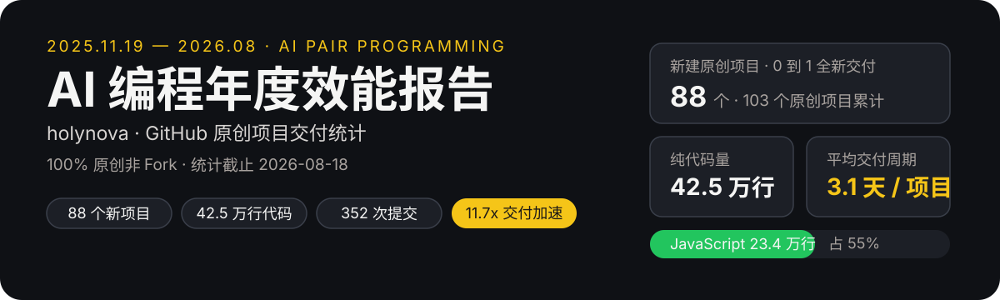
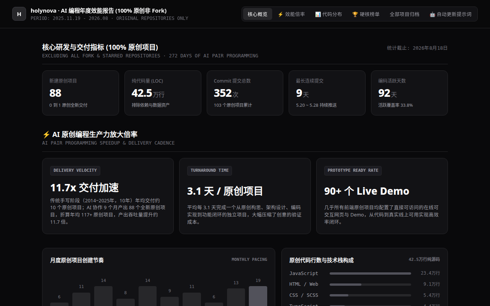

<p align="right"><a href="README.md">中文</a></p>

<p align="center">
  
</p>

<p align="center">
  <a href="https://holynova.github.io/ai-coding-report/">▶ Read Online</a>
  ·
  <a href="https://github.com/holynova/ai-coding-report">GitHub Repository</a>
</p>

This report tracks original-project delivery and engineering productivity on GitHub since fully adopting AI-assisted programming on 2025-11-19: as of 2026-08-18, 88 new original projects, 103 active original projects, 425K lines of pure code, 352 commits — about 11.7× the delivery pace of the pre-AI hand-coding years. The page embeds an AI auto-update prompt so the numbers can be refreshed at any time.

## Screenshot

<p align="center">
  
</p>

## Key Metrics (as of 2026-08-18)

| Metric | Value | Notes |
|---|---|---|
| New original projects | 88 | Built from scratch, 0 to 1 |
| Refreshed legacy projects | 15 | Older projects under active maintenance |
| Active original projects | 103 | Projects with commits during the period |
| Pure code | 425K lines | Excluding dependencies and data assets |
| Total commits | 352 | Across the 103 original projects |
| Longest commit streak | 9 days | 5.20–5.28, continuous pushes |
| Active coding days | 92 | 33.8% coverage |
| Period covered | 272 days | 2025.11.19 – 2026.08 |

All stats cover 100% original, non-fork repositories only; forks and starred repos are excluded.

## Productivity

- **11.7× delivery speedup**: the hand-coding years (2014–2025, 10 years) averaged about 10 original projects per year; 9 months of AI collaboration produced 88 brand-new original projects — an annualized rate of 117+.
- **3.1 days per original project**: on average, one standalone project goes from original idea through architecture and implementation to a working product every 3.1 days.
- **90+ live demos**: nearly every frontend original project ships with a directly accessible, interactive online demo.

## Codebase

- JavaScript 234K lines, HTML / Web 91K, CSS / SCSS 54K, TypeScript 44K.
- Largest original projects by code size: char_finder (87K lines), my-design-system (83K), brand-etymology (45K).
- Most iterated original projects: collection_miner (53 commits), scrape-to-markdown.chrome (28 commits).
- Open-source standout: gushi_namer (a classical-poetry baby-naming tool, 2,200+ GitHub stars).

## What's Inside

- **Key metrics**: new / refreshed / active project counts, lines of code, commits, active days.
- **Productivity multipliers**: delivery speedup, average delivery cycle, live demo coverage.
- **Monthly pacing & code distribution**: new projects per month, tech-stack breakdown.
- **Leaderboards**: TOP 5 by code size, TOP 5 by iteration frequency.
- **Curated highlights**: my-design-system, win98-screen-saver, kaleidoscope-studio, flash-card, photo_align, gushi_namer.
- **Full project archive**: a panoramic list of all 103 original projects, filterable by new/refreshed and tech stack.
- **AI auto-update prompt**: built into the bottom of the page — copy it to any AI coding agent and it will fetch the latest GitHub data and update this report automatically.

## Read Locally

A pure static single page — just open `index.html`, or serve it statically:

```bash
python3 -m http.server 8000
# Open http://localhost:8000
```
